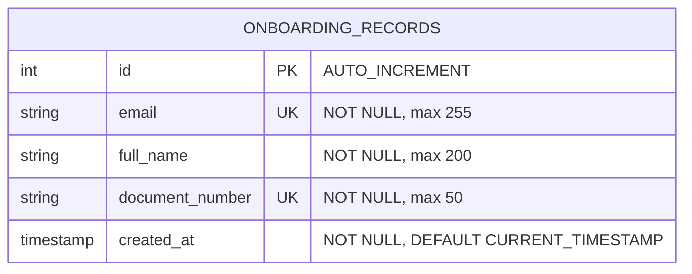

# Mini KYC

Identity registration and document verification using OCR and artificial intelligence.

Mini KYC is a web application that allows users to register their identity by providing an email address and an image of an identity document. The backend validates the image, extracts the document information using Google's Gemini API, validates the extracted data, and stores the registration in a MySQL database through a stored procedure.

## Live demo

- **Application:** https://remarkable-emotion-production-0d95.up.railway.app
- **API documentation (Swagger):** https://mini-kyc-production.up.railway.app/docs

## Features

- **Identity registration:** Register users using an email address and an identity document.
- **OCR integration:** Extract the full name and document number from document images using Gemini.
- **Blurry image detection:** Reject low-quality images before calling the OCR service.
- **Data validation:** Validate extracted fields before saving them.
- **Duplicate prevention:** Enforce unique email addresses and document numbers.
- **Stored procedure persistence:** Registrations are saved through `sp_create_onboarding_record`.
- **Registered users view:** A second tab lists all registrations, newest first.
- **REST API:** Endpoints for registration, OCR extraction, listing, and health checks, documented with Swagger.
- **Frontend validation:** Validate email addresses, file types, and image sizes.
- **Environment configuration:** All settings and credentials are loaded from environment variables.
- **CORS configuration:** Allowed origins are configurable through `CORS_ORIGINS`.

## Technologies

### Frontend
- React
- TypeScript
- Vite
- Formik
- Yup
- CSS

### Backend
- Python
- FastAPI
- Uvicorn
- SQLAlchemy
- PyMySQL
- Pydantic and pydantic-settings
- OpenCV (blur detection)
- Google Gen AI SDK
- pytest

### Database and infrastructure
- MySQL
- Docker Compose (local database)
- Google Gemini API
- Railway (deployment)

## Stack justification

- **React + TypeScript + Vite:** component-based UI with static typing and a fast development workflow.
- **Formik + Yup:** declarative form handling and a validation schema kept outside the component.
- **FastAPI:** native `multipart/form-data` support, Pydantic validation, and automatic Swagger documentation.
- **MySQL + stored procedures:** relational storage with unique constraints and persistence encapsulated in the database.
- **Gemini:** multimodal model that extracts structured fields directly from the document image.
- **Docker Compose:** reproducible local database.
- **Railway:** simple deployment of the frontend, backend, and database from one repository.

## Architecture

The backend separates responsibilities into layers. Each layer only depends on the one below it.

```text
Router  ->  Service  ->  Repository  ->  Stored procedure (MySQL)
                |
                +------>  OCR service (Gemini)
```

- **Routers (`routers/`):** receive HTTP requests, read uploaded files, and return responses. They contain no business logic.
- **Services (`services/`):** business logic. File validation, blur detection, OCR extraction, and the registration flow. They know nothing about HTTP.
- **Repositories (`repositories/`):** data access. Calls the stored procedure and translates database errors into domain errors.
- **Exceptions (`exceptions.py`):** domain errors raised by services and repositories.
- **Error handlers (`error_handlers.py`):** a single place that maps domain errors to HTTP responses.
- **Config (`config.py`):** all settings are read once from environment variables.

The frontend follows the same idea:

- **Components:** presentation only.
- **Hooks:** state and side effects (`useRegistration`, `useRegistrations`, `useFilePreview`, `useScrollIntoViewOnMobile`).
- **Services:** HTTP communication (`apiClient`, `registrationService`).
- **Validation and config:** form schema and constants kept outside components.

Diagrams are available in `docs/`:

- `docs/sequence-diagram.mmd`: main flow (user, frontend, API, OCR service, database).
- `docs/data-model.mmd`: data model.

## Project structure

```text
mini-kyc/
├── backend/
│   ├── app/
│   │   ├── routers/
│   │   │   ├── health.py
│   │   │   ├── ocr.py
│   │   │   └── registrations.py
│   │   ├── services/
│   │   │   ├── document_service.py
│   │   │   ├── image_validation.py
│   │   │   ├── ocr_service.py
│   │   │   └── registration_service.py
│   │   ├── repositories/
│   │   │   └── registration_repository.py
│   │   ├── __init__.py
│   │   ├── config.py
│   │   ├── database.py
│   │   ├── error_handlers.py
│   │   ├── exceptions.py
│   │   └── schemas.py
│   ├── tests/
│   ├── .env.example
│   ├── pytest.ini
│   ├── requirements.txt
│   ├── requirements-dev.txt
│   └── run.py
├── database/
│   ├── schema.sql
│   └── stored_procedures.sql
├── docs/
│   ├── data-model.mmd
│   └── sequence-diagram.mmd
├── frontend/
│   ├── src/
│   │   ├── components/
│   │   │   ├── icons/
│   │   │   ├── FileUploadField.tsx
│   │   │   ├── Navbar.tsx
│   │   │   ├── RecognitionResult.tsx
│   │   │   ├── RegistrationForm.tsx
│   │   │   ├── RegistrationsList.tsx
│   │   │   └── TabNav.tsx
│   │   ├── config/
│   │   ├── hooks/
│   │   ├── services/
│   │   ├── types/
│   │   ├── utils/
│   │   ├── validation/
│   │   ├── App.tsx
│   │   ├── App.css
│   │   └── main.tsx
│   ├── .env.example
│   └── package.json
├── .env.example
├── .gitignore
├── PROMPTS.md
├── README.md
└── compose.yaml
```

## Requirements

Install the following tools before running the project:

- [Python](https://www.python.org/downloads/)
- [Node.js](https://nodejs.org/) and npm
- [Docker Desktop](https://www.docker.com/products/docker-desktop/)
- A Google Gemini API key from [Google AI Studio](https://aistudio.google.com/)

## Configuration

### 1. Clone the repository

```bash
git clone https://github.com/LushoCallapa/mini-kyc.git
cd mini-kyc
```

### 2. Configure the root environment

Create a `.env` file in the project root using `.env.example` as a template.

```dotenv
MYSQL_ROOT_PASSWORD=your_mysql_password
```

Use a secure password of your choice.

### 3. Configure the backend environment

Create `backend/.env` using `backend/.env.example` as a template.

```dotenv
DB_HOST=127.0.0.1
DB_PORT=3306
DB_NAME=mini_kyc
DB_USER=root
DB_PASSWORD=your_mysql_password

GEMINI_API_KEY=your_gemini_api_key
GEMINI_MODEL=gemini-3.5-flash-lite

CORS_ORIGINS=http://localhost:5173
```

Make sure `DB_PASSWORD` matches `MYSQL_ROOT_PASSWORD` and replace the Gemini API key with your own.

All variables are required. The API will not start if one is missing.

`CORS_ORIGINS` accepts several origins separated by commas. When you deploy, include the public URL of the frontend.

The Gemini model shown above is an example. Use a model ID currently supported by your API key and account.

### 4. Configure the frontend environment

Create `frontend/.env` using `frontend/.env.example` as a template.

```dotenv
VITE_API_URL=http://127.0.0.1:8000
```

This variable defines the base URL used by the frontend to communicate with the backend. It is read at build time.

## Database setup

### 1. Start MySQL

From the project root, run:

```bash
docker compose up -d mysql
```

Verify that the container is running:

```bash
docker compose ps
```

### 2. Create the database, table, and stored procedure

Apply both SQL files, in this order:

```bash
docker exec -e MYSQL_PWD=your_mysql_password -i mini-kyc-mysql mysql -u root < database/schema.sql
docker exec -e MYSQL_PWD=your_mysql_password -i mini-kyc-mysql mysql -u root < database/stored_procedures.sql
```

Replace `your_mysql_password` with the value configured in the root `.env` file.

- `schema.sql` creates the `mini_kyc` database and the `onboarding_records` table, including unique constraints for email addresses and document numbers.
- `stored_procedures.sql` creates `sp_create_onboarding_record`, which the API uses to save registrations.

> **Note:** If your existing database already contains data, review the SQL before applying any changes that could delete or recreate objects.

## Backend setup

### 1. Open the backend directory

```bash
cd backend
```

### 2. Create a virtual environment

On Windows PowerShell:

```powershell
python -m venv .venv
.\.venv\Scripts\Activate.ps1
```

If PowerShell blocks script execution, activate the environment using the appropriate method for your system.

On Linux or macOS:

```bash
python3 -m venv .venv
source .venv/bin/activate
```

### 3. Install dependencies

```bash
python -m pip install --upgrade pip
pip install -r requirements.txt
```

### 4. Run the API

```bash
python run.py
```

The backend will be available at:

- API base URL: `http://127.0.0.1:8000`
- Interactive API documentation (Swagger): `http://127.0.0.1:8000/docs`
- Alternative API documentation: `http://127.0.0.1:8000/redoc`

## Frontend setup

Open a separate terminal.

### 1. Navigate to the frontend

```bash
cd frontend
```

### 2. Install dependencies

```bash
npm install
```

### 3. Start the development server

```bash
npm run dev
```

Vite will display the local URL, usually:

`http://localhost:5173`

Open that address in your browser.

## Running tests

From the `backend` directory, with the virtual environment active:

```bash
pip install -r requirements-dev.txt
pytest
```

The tests cover file validation, blur detection, and data schemas. They do not require MySQL or the Gemini API.

## API endpoints

| Method | Endpoint | Description |
|---|---|---|
| `GET` | `/health` | Check API availability. |
| `GET` | `/health/database` | Check database connectivity. |
| `POST` | `/ocr/extract` | Extract identity information from an image. |
| `GET` | `/registrations` | List registrations, newest first (optional `limit`, default 100). |
| `POST` | `/registrations` | Create a registration using JSON data. |
| `POST` | `/registrations/with-document` | Extract document information and create a registration. |

### Registration with an identity document

The endpoint `POST /registrations/with-document` expects a `multipart/form-data` request with:

- `email`: user's email address.
- `file`: identity document image.

Supported image formats are JPEG, PNG, and WebP, with a maximum size of 5 MB.

The backend validates the image, extracts the data with Gemini, validates the extracted fields, and saves the registration in MySQL. Duplicate email addresses or document numbers are rejected.

### Example request

```bash
curl -X POST \
  http://127.0.0.1:8000/registrations/with-document \
  -F "email=user@example.com" \
  -F "file=@document.jpg"
```

Replace `document.jpg` with the path to an image you are authorized to use for testing.

## Application workflow

1. The user enters an email address and selects an identity document image.
2. The frontend validates the email, file type, and file size.
3. The frontend sends the form to the FastAPI backend.
4. The backend validates the file type, size, and sharpness.
5. The backend sends the image to Gemini for OCR extraction.
6. The backend validates the extracted full name and document number.
7. The repository calls the stored procedure, which checks database constraints and saves the registration.
8. The API returns the registration result or an appropriate error response.
9. The frontend displays the result to the user.

## Data model

Each successful onboarding is stored as one row in `onboarding_records`. Persistence is done through the stored procedure `sp_create_onboarding_record`.



- `email` and `document_number` are unique, which prevents duplicate registrations.
- `created_at` stores the registration timestamp.
- The model is intentionally a single table for this PoC. It can be normalized later (for example, a `customers` table with one-to-many onboarding records) if a customer needs several documents or verification attempts.
- `id` values may have gaps: MySQL consumes an auto-increment value even when an insert is rejected by a unique constraint.

## UI mockup

Figma: https://www.figma.com/design/YOUR_FILE_LINK

## Deployment (Railway)

The project is deployed as three services in one Railway project.

| Service | Source | Configuration |
|---|---|---|
| MySQL | Railway MySQL | Database `mini_kyc`, created with the SQL files in `database/`. |
| Backend | Repository, root directory `/backend` | Start command: `uvicorn app:create_app --factory --host 0.0.0.0 --port $PORT` |
| Frontend | Repository, root directory `/frontend` | Built with Vite and served as a static site. |

**Backend variables** (secrets are never committed):

```dotenv
DB_HOST=${{MySQL.MYSQLHOST}}
DB_PORT=${{MySQL.MYSQLPORT}}
DB_NAME=mini_kyc
DB_USER=${{MySQL.MYSQLUSER}}
DB_PASSWORD=${{MySQL.MYSQLPASSWORD}}
GEMINI_API_KEY=your_gemini_api_key
GEMINI_MODEL=your_gemini_model
CORS_ORIGINS=https://your-frontend-domain
```

**Frontend variable** (read at build time, so redeploy after changing it):

```dotenv
VITE_API_URL=https://your-backend-domain
```

**Steps**

1. Create the MySQL service and apply `database/schema.sql` and `database/stored_procedures.sql` to it.
2. Create the backend service, set its root directory, start command, and variables, and generate a public domain.
3. Create the frontend service, set `VITE_API_URL` to the backend domain, and generate a public domain.
4. Add the frontend domain to `CORS_ORIGINS` in the backend and redeploy it.

## Validation and error handling

The application validates data at both the frontend and backend levels. The backend never returns a generic 500 for invalid input: services raise domain errors and a global handler converts them into controlled responses.

| Case | HTTP status |
|---|---|
| Unsupported file type | 415 |
| Empty file | 400 |
| File larger than 5 MB | 413 |
| File is not a valid image | 400 |
| Blurry image | 422 |
| Incomplete or invalid extracted data | 422 |
| OCR service unavailable | 503 |
| OCR service invalid response | 502 |
| Duplicate email or document number | 409 |
| Could not save the registration | 500 |
| Database unavailable | 503 |

## AI prompts

All prompts used with the AI/OCR service are documented in [PROMPTS.md](PROMPTS.md).

